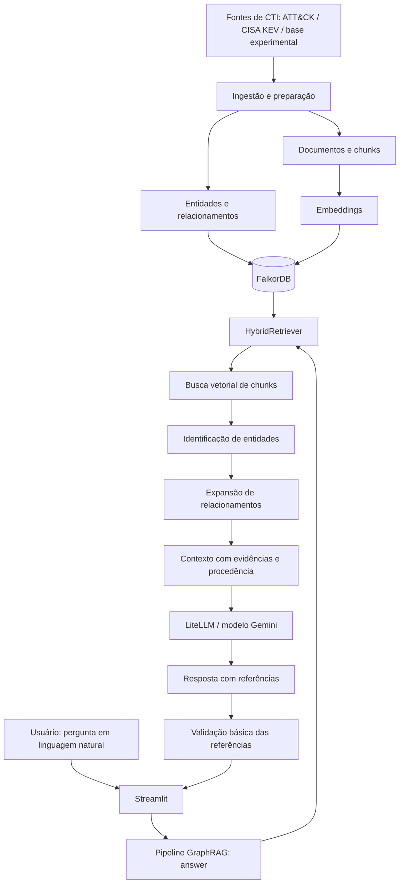

# CTI GraphRAG — Documentação Técnica do Projeto

> **Documento de apoio à documentação acadêmica e técnica**  
> **Versão:** 0.1 — novembro de 2026  
> **Status:** protótipo funcional em evolução  
> **Idioma:** português (documentação); inglês (código, identificadores e dados de origem)

---

## 1. Apresentação

O **CTI GraphRAG** é um sistema experimental de Inteligência de Ameaças Cibernéticas (*Cyber Threat Intelligence — CTI*) que combina recuperação semântica de documentos com consultas a um banco de dados em grafo e geração de respostas por um modelo de linguagem (*Large Language Model — LLM*).

O objetivo é permitir que um usuário faça perguntas em linguagem natural sobre grupos de ameaças, ferramentas, malwares, técnicas e suas relações. Em vez de solicitar ao LLM que responda apenas com seu conhecimento prévio, o sistema recupera primeiro informações armazenadas no grafo de conhecimento e utiliza essas evidências para formular uma resposta acompanhada de referências.

A proposta acadêmica prevê o uso de dados do **MITRE ATT&CK Enterprise** e do catálogo **CISA Known Exploited Vulnerabilities (KEV)**. O projeto utiliza Python, FalkorDB, sentence-transformers, LiteLLM, Pydantic, Streamlit e PyVis.

> **Importante sobre o estado atual:** o protótipo de recuperação e interface já foi executado com dados experimentais carregados no grafo `cti_gold`. A preparação dos arquivos STIX do MITRE ATT&CK Enterprise 20.1 foi concluída, mas a carga desses arquivos na base oficial ainda precisa ser validada e promovida. A integração do catálogo CISA KEV e a comparação completa entre `cti_gold` e `cti_extracted` também permanecem como etapas de desenvolvimento. Portanto, os resultados atuais não devem ser descritos como se já tivessem sido produzidos integralmente pela base oficial ATT&CK + KEV.

## 2. Objetivos

### 2.1 Objetivo geral

Desenvolver um protótipo de GraphRAG para apoiar a investigação e a consulta de informações de inteligência de ameaças cibernéticas, combinando evidências textuais e relações estruturadas em um grafo de conhecimento.

### 2.2 Objetivos específicos

- Ingerir e organizar informações públicas de CTI em uma estrutura de grafo.
- Representar entidades como grupos de ameaça, softwares, técnicas, táticas, vulnerabilidades, produtos e fornecedores.
- Armazenar documentos e trechos textuais (*chunks*) para preservar a procedência das informações.
- Gerar embeddings para recuperar trechos semanticamente relevantes a partir de perguntas em linguagem natural.
- Identificar entidades mencionadas nos trechos recuperados e expandir seus relacionamentos no grafo.
- Utilizar um LLM para sintetizar as evidências recuperadas em português.
- Apresentar ao usuário a resposta, as referências, os caminhos do grafo, os nós, as arestas e as consultas Cypher utilizadas.
- Avaliar a qualidade da recuperação e das respostas por meio de um conjunto de perguntas de teste.

## 3. Escopo e fontes de dados

### 3.1 Fontes planejadas

| Fonte | Finalidade | Situação no projeto |
|---|---|---|
| MITRE ATT&CK Enterprise (STIX 2.1) | Grupos, softwares, técnicas, táticas e relacionamentos documentados | Arquivo da versão 20.1 baixado e preparado; carga no grafo oficial ainda precisa ser validada |
| CISA KEV | Catálogo de vulnerabilidades conhecidamente exploradas | Integração planejada; não considerar concluída sem evidência de ingestão |
| Brandefense Threat Actor Dataset | Base experimental usada para desenvolver e testar o importador e a recuperação | Já foi carregada no grafo `cti_gold` durante a fase de prototipação |

O uso de uma base experimental permitiu desenvolver o fluxo de consulta antes da conclusão da ingestão oficial. Para os resultados acadêmicos finais, a origem dos dados deverá ser identificada em cada experimento, evitando misturar resultados de fontes distintas.

### 3.2 Arquivo MITRE ATT&CK preparado

Durante a preparação da base ATT&CK Enterprise 20.1, o inventário identificou objetos como `intrusion-set`, `malware`, `tool`, `attack-pattern` e `x-mitre-tactic`, além de relacionamentos como `uses`, `subtechnique-of` e `belongs-to` (mapeado a partir das fases da cadeia de ataque).

A auditoria de relacionamentos não mapeados identificou 21.822 registros fora do mapeamento implementado naquele estágio:

| Motivo registrado pela auditoria | Quantidade |
|---|---:|
| `unsupported_relationship_type` | 18.068 |
| `unsupported_endpoint` | 3.595 |
| `source_inactive` | 159 |
| **Total** | **21.822** |

Entre os tipos observados estavam `uses`, `mitigates`, `detects`, `subtechnique-of`, `revoked-by` e `attributed-to`. Esses registros não devem ser tratados automaticamente como erros do dataset: representam relacionamentos que o mapeamento atual ainda não incorpora ou cujas pontas não são suportadas pelo subconjunto de entidades importado. A inclusão de novos tipos exige atualização do schema, do importador, da recuperação e dos testes.

## 4. Arquitetura da solução

A arquitetura é dividida em módulos para separar ingestão, armazenamento, recuperação, geração da resposta e apresentação.



### 4.1 Componentes tecnológicos

| Tecnologia | Papel no sistema |
|---|---|
| Python | Linguagem de implementação e integração dos módulos |
| FalkorDB | Banco de dados em grafo; também oferece recursos de índices vetoriais e full-text |
| Docker | Execução local do serviço FalkorDB em ambiente isolado |
| sentence-transformers | Geração local de embeddings de perguntas e trechos |
| `intfloat/multilingual-e5-small` | Modelo de embeddings utilizado no protótipo atual, com vetores de 384 dimensões |
| LiteLLM | Camada de integração com provedores de modelos de linguagem |
| Gemini | Modelo utilizado no teste funcional de geração de respostas |
| Pydantic | Definição e validação da estrutura do objeto de resposta |
| Streamlit | Interface web para perguntas, respostas e procedência |
| PyVis | Visualização interativa do subgrafo recuperado |
| python-dotenv | Carregamento das configurações do arquivo `.env` |

**Diferença em relação à configuração originalmente planejada:** o plano inicial especificava `BAAI/bge-small-en-v1.5` para embeddings. O protótipo atual utiliza `intfloat/multilingual-e5-small`, também com 384 dimensões. Embora possuam a mesma dimensão, os espaços vetoriais produzidos pelos dois modelos são diferentes. Não se deve misturar embeddings dos dois modelos no mesmo índice; uma migração exige regenerar os vetores dos documentos com o modelo escolhido e manter o modelo correspondente para as consultas.

### 4.2 Organização dos grafos

A arquitetura prevê dois grafos lógicos na mesma instância FalkorDB:

- **`cti_gold`:** base de referência construída a partir de fontes oficiais e curadas, destinada a funcionar como gabarito.
- **`cti_extracted`:** base que deverá armazenar entidades e relacionamentos identificados pelo processo de extração com LLM.

A comparação entre esses grafos permitirá medir a qualidade da extração. Na versão experimental atual, `cti_gold` também foi usado para armazenar a carga inicial da Brandefense; essa situação deve ser corrigida ou claramente separada antes da avaliação oficial.

## 5. Modelo de dados do grafo

O schema do projeto define 11 labels de nós e 10 tipos de relacionamentos. O arquivo `schema/schema.yaml` é a referência central para os nomes e contratos do modelo.

### 5.1 Entidades

| Label | Significado | Exemplos de propriedades |
|---|---|---|
| `Group` | Grupo/ator de ameaça | `id`, `name`, `aliases`, `description` |
| `Software` | Malware ou ferramenta | `id`, `name`, `type`, `aliases`, `description` |
| `Technique` | Técnica ou subtécnica | `id`, `name`, `is_subtechnique`, `description` |
| `Tactic` | Tática do ATT&CK | `id`, `name`, `shortname` |
| `Vulnerability` | Vulnerabilidade | `id`, `description`, `date_added` |
| `Product` | Produto afetado | `id`, `name` |
| `Vendor` | Fabricante/fornecedor | `id`, `name` |
| `Sector` | Setor econômico ou de atividade | `id`, `name` |
| `Country` | País associado | `id`, `name` |
| `Document` | Documento de origem | `id`, `title`, `url`, `source` |
| `Chunk` | Trecho textual de um documento | `id`, `text`, `embedding` |

### 5.2 Relacionamentos

| Relacionamento | Origem → destino | Interpretação |
|---|---|---|
| `USES` | `Group` → `Software`; `Group` → `Technique`; `Software` → `Technique` | Utiliza |
| `BELONGS_TO` | `Technique` → `Tactic` | Pertence à tática |
| `SUBTECHNIQUE_OF` | `Technique` → `Technique` | Subtécnica de |
| `AFFECTS` | `Vulnerability` → `Product` | Afeta o produto |
| `MADE_BY` | `Product` → `Vendor` | Fabricado por |
| `EXPLOITS` | `Group` ou `Software` → `Vulnerability` | Explora |
| `TARGETS` | `Group` → `Sector` ou `Country` | Tem como alvo |
| `ASSOCIATED_WITH` | `Group` → `Country` | Associado a |
| `PART_OF` | `Chunk` → `Document` | Trecho pertencente ao documento |
| `MENTIONED_IN` | Entidade → `Chunk` | Entidade mencionada no trecho |

Relacionamentos semânticos devem preservar metadados de procedência, como `source`, `chunk_id`, `evidence` e `confidence`, conforme o contrato do projeto. Os relacionamentos estruturais `PART_OF` e `MENTIONED_IN` permitem rastrear a origem dos fatos.

### 5.3 Identificadores canônicos

| Entidade | Padrão de identificação | Exemplo |
|---|---|---|
| `Group` | ID ATT&CK | `G0016` |
| `Software` | ID ATT&CK | `S0154` |
| `Technique` | ID ATT&CK | `T1566.001` |
| `Tactic` | ID ATT&CK | `TA0001` |
| `Vulnerability` | CVE | `CVE-2023-23397` |
| `Vendor` | `vendor:<slug>` | `vendor:microsoft` |
| `Product` | `product:<vendor>:<slug>` | `product:microsoft:exchange_server` |
| `Sector` | `sector:<slug>` | `sector:financial` |
| `Country` | `country:<ISO-2>` | `country:KP` |
| `Document` | `doc:<source>:<source-id>` | `doc:attack:G0016` |
| `Chunk` | `<document-id>#<índice>` | `doc:attack:G0016#2` |

A padronização dos IDs evita duplicação de entidades e facilita a comparação entre os dados oficiais e os dados extraídos.

## 6. Fluxo de ingestão e preparação

A ingestão transforma os dados de origem em registros adequados ao grafo.

1. **Download:** obtenção dos arquivos públicos de CTI.
2. **Parsing:** leitura dos objetos STIX ou JSON e identificação dos tipos relevantes.
3. **Normalização:** padronização de nomes, aliases, IDs e propriedades.
4. **Construção dos documentos:** criação de nós `Document` com título, URL e fonte.
5. **Chunking:** divisão dos textos em trechos menores, armazenados como nós `Chunk`.
6. **Relacionamentos estruturais:** ligação dos chunks aos documentos por `PART_OF` e das entidades aos chunks por `MENTIONED_IN`.
7. **Embeddings:** geração de vetores para os trechos, respeitando o modelo e a dimensão configurados.
8. **Carga no grafo:** gravação dos nós e relacionamentos no grafo de destino.

Os arquivos intermediários em JSON/JSONL devem ser preservados em `data/raw/` e `data/processed/`, conforme o fluxo de ingestão, para permitir auditoria e reprocessamento. Dados e chaves privadas não devem ser versionados no Git.

### 6.1 Preservação de procedência

Cada chunk deve conservar pelo menos o identificador, o documento de origem, a URL/fonte e o texto. Quando um relacionamento é extraído de um documento, seu `chunk_id` e sua evidência textual devem ser mantidos. Dessa forma, uma resposta pode apontar para o trecho que fundamenta a afirmação.

## 7. Recuperação híbrida

O módulo `HybridRetriever` combina busca vetorial com navegação no grafo.

### 7.1 Busca semântica

A pergunta é codificada pelo modelo `intfloat/multilingual-e5-small`, utilizando o prefixo `query:`. O FalkorDB compara o vetor da pergunta com os vetores dos nós `Chunk` por meio do índice vetorial e retorna os trechos mais semelhantes.

No protótipo, a consulta vetorial utiliza `db.idx.vector.queryNodes` e recupera informações do documento ligado ao chunk por `PART_OF`.

### 7.2 Identificação de entidades

A partir dos chunks retornados, o sistema procura entidades relacionadas por `MENTIONED_IN`. Os resultados são filtrados pelos labels de interesse para CTI e ordenados pela similaridade do chunk associado.

### 7.3 Expansão do grafo

Para cada entidade identificada, o `GraphRetriever` consulta relacionamentos direcionados e recupera os nós de origem e destino, o tipo de relação e as evidências documentais associadas.

A implementação inicial expande um conjunto limitado de relacionamentos. A ampliação para todos os tipos definidos no schema deve ser acompanhada de testes para garantir que os sentidos e os endpoints estejam corretos.

### 7.4 Limitações conhecidas da recuperação atual

- A expansão executa consultas por entidade-semente, podendo aumentar a latência quando muitos nós são identificados.
- O filtro de relacionamentos da primeira versão não cobre necessariamente todos os tipos definidos no schema.
- A expansão pode trazer relações relacionadas ao mesmo chunk, mas que não respondem diretamente à intenção da pergunta; é necessário melhorar a seleção por tipo de pergunta.
- A busca atual é centrada em chunks e entidades mencionadas. Ela ainda não equivale a uma recuperação multi-hop completa de caminhos arbitrários.
- A similaridade vetorial é um indicador de proximidade entre vetores, não uma probabilidade de verdade.

## 8. Geração da resposta com LLM

O módulo `llm/client.py` utiliza LiteLLM para enviar ao modelo uma pergunta e o contexto montado pelo pipeline. O nome do modelo e a chave de API são carregados por variáveis de ambiente, evitando fixar credenciais no código.

O prompt de sistema estabelece que o modelo deve:

- responder em português;
- utilizar exclusivamente as evidências fornecidas;
- não inventar entidades ou relações;
- apresentar referências no formato `[P1]`, `[P2]` etc.;
- reconhecer quando o contexto não contém informação suficiente;
- diferenciar fatos documentados de inferências.

O pipeline converte os relacionamentos e trechos recuperados em blocos de contexto identificados por referências. Após a geração, a versão atual verifica se as referências citadas existem entre os caminhos recuperados.

**Limitação da validação:** a verificação atual é sintática: confirma a existência do identificador `[P#]`, mas ainda não comprova automaticamente que cada frase está de fato sustentada pela evidência associada. Essa validação semântica deve ser implementada antes de alegar prevenção completa de alucinações.

## 9. Interface e explicabilidade

A interface é implementada em Streamlit e tem como objetivo permitir o uso do sistema sem que o usuário precise escrever consultas Cypher.

Na versão de protótipo, a interface contempla:

- campo de entrada de perguntas em linguagem natural;
- histórico de mensagens durante a sessão;
- resposta gerada pelo LLM;
- caminhos e referências de evidência;
- identificadores dos nós e relacionamentos;
- visualização do subgrafo com PyVis;
- exibição das consultas Cypher registradas;
- indicador de recuperação e tempo total de processamento.

O indicador apresentado na interface corresponde à média das similaridades semânticas recuperadas na implementação atual. Ele não deve ser chamado de “probabilidade de acerto” nem de confiança calibrada. O campo `confidence` deverá ser redefinido ou calibrado por avaliação empírica antes de ser interpretado probabilisticamente.

## 10. Contrato de resposta

O pipeline retorna um objeto Pydantic `Answer`, que separa o texto da resposta dos elementos de procedência.

| Campo | Descrição |
|---|---|
| `answer` | Texto produzido pelo LLM |
| `paths` | Caminhos/referências utilizados para fundamentar a resposta |
| `nodes` | Nós relevantes para a visualização do subgrafo |
| `edges` | Arestas entre os nós recuperados |
| `cypher` | Consultas utilizadas durante a recuperação |
| `confidence` | Indicador numérico de recuperação, ainda não calibrado |
| `latency_ms` | Tempo total medido pelo pipeline em milissegundos |

Esse contrato permite que a interface apresente resultados sem acessar diretamente a lógica interna de recuperação.

## 11. Instalação e execução

As instruções completas para instalação por uma pessoa iniciante devem ficar no arquivo `README.md`, na raiz do repositório. Esta seção resume o fluxo para referência técnica.

### 11.1 Pré-requisitos

- Windows 10/11 ou sistema compatível com Python e Docker;
- Python e `pip` instalados;
- Docker Desktop instalado e em execução;
- acesso à internet para baixar dependências, o modelo de embeddings e utilizar o Gemini via API;
- chave de API válida do provedor configurado.

### 11.2 Preparar o ambiente Python

No PowerShell, acessar a pasta raiz do projeto e executar:

```powershell
python -m venv venv
.\venv\Scripts\Activate.ps1
python -m pip install --upgrade pip
pip install -r requirements.txt
```

Caso o projeto ainda não tenha todas as dependências no `requirements.txt`, instalar também as dependências utilizadas pela aplicação:

```powershell
pip install streamlit pyvis pydantic python-dotenv falkordb sentence-transformers litellm
```

### 11.3 Configurar variáveis de ambiente

Criar `.env` na raiz do projeto. Exemplo de estrutura:

```env
FALKORDB_HOST=127.0.0.1
FALKORDB_PORT=6379
GRAPH_NAME=cti_gold

LLM_PROVIDER=gemini
LLM_MODEL=gemini/ID_DO_MODELO_CONFIGURADO
GEMINI_API_KEY=SUA_CHAVE_API
```

Os valores de exemplo devem ser substituídos pelos dados reais. A chave não deve ser enviada em mensagens, incluída em capturas de tela ou adicionada ao Git. O arquivo `.env` deve estar listado no `.gitignore`.

### 11.4 Iniciar o FalkorDB

Se o container do projeto já existir:

```powershell
docker start cti-falkordb
```

Se ainda não existir, criar o container com as portas locais utilizadas pelo projeto:

```powershell
docker run -d --name cti-falkordb -p 6379:6379 -p 3000:3000 falkordb/falkordb:latest
```

Verificar se está em execução:

```powershell
docker ps
```

A porta `6379` é utilizada pela aplicação Python. A porta `3000` disponibiliza a interface web do FalkorDB quando habilitada na imagem/configuração utilizada.

### 11.5 Executar a aplicação

A partir da raiz do repositório, com o ambiente virtual ativado e o FalkorDB em execução:

```powershell
streamlit run src/cti_graphrag/ui/app.py
```

O Streamlit normalmente disponibiliza a aplicação em `http://localhost:8501`.

### 11.6 Teste funcional sugerido

Pergunta de exemplo:

> Quais ferramentas são utilizadas pelo grupo Andariel?

O teste deve observar se a aplicação:

1. recupera chunks semanticamente relacionados;
2. identifica entidades mencionadas nesses chunks;
3. encontra relacionamentos pertinentes no grafo;
4. monta contexto com evidências;
5. gera resposta em português com referências;
6. apresenta os caminhos, o subgrafo e as consultas utilizadas.

O resultado depende dos dados efetivamente carregados no grafo configurado em `GRAPH_NAME`.

## 12. Testes e validação

Os testes devem ser separados por camada, para que erros de ingestão, banco, recuperação, LLM e interface possam ser identificados individualmente.

| Camada | Verificação recomendada | Evidência de aprovação |
|---|---|---|
| Banco | Conectar e consultar contagem de nós/arestas | Consulta retorna sem erro |
| Embeddings | Verificar existência e dimensão dos vetores | Dimensão compatível com o índice |
| Busca vetorial | Executar pergunta conhecida | Chunks relevantes retornados |
| Entidades | Identificar entidades mencionadas nos chunks | IDs e labels esperados |
| Relacionamentos | Consultar relações de uma entidade conhecida | Origem, destino e evidência coerentes |
| LLM | Fornecer contexto de teste controlado | Resposta coerente e citações existentes |
| Pipeline | Executar pergunta do início ao fim | Objeto `Answer` preenchido |
| Interface | Executar a pergunta no Streamlit | Resposta e procedência exibidas |

### 12.1 Teste isolado do LLM

O arquivo de teste isolado pode fornecer um contexto fixo para confirmar a comunicação com o provedor antes de testar o pipeline completo. Esse teste valida a integração com o LLM, mas não comprova a qualidade da recuperação do FalkorDB.

### 12.2 Avaliação acadêmica planejada

O plano prevê um conjunto de 30 perguntas em `eval/questions.csv`, com campos para pergunta, resposta esperada, IDs esperados, quantidade de saltos e categoria. A avaliação deverá comparar, no mínimo, as respostas e a recuperação em diferentes configurações, registrando métricas e limitações.

As métricas exatas devem ser definidas antes dos experimentos. Sugestões incluem precisão e revocação de entidades/relacionamentos recuperados, cobertura das evidências, validade das citações, latência e avaliação humana da resposta. Não apresentar resultados dessas métricas sem executar os testes correspondentes.

## 13. Segurança, privacidade e limitações

- As chaves de API devem permanecer em variáveis de ambiente e fora do controle de versão.
- As respostas devem ser consideradas apoio à análise, não confirmação independente de um incidente.
- A existência de uma relação no grafo significa que ela foi registrada pela fonte/processamento correspondente; a procedência deve ser examinada antes de tomar decisões.
- Similaridade vetorial não é sinônimo de relevância factual ou confiança estatística.
- A validação básica de referências não garante, por si só, ausência de alucinações.
- O conteúdo do documento recuperado deve ser tratado como dado não confiável, não como instrução para o LLM.
- Consultas geradas pelo modelo, caso o recurso Text-to-Cypher seja implementado, deverão ser validadas e limitadas a operações somente de leitura, labels e propriedades permitidos e limites de resultados.
- A aplicação depende de conectividade com o provedor de LLM quando configurada para uso via API.

## 14. Limitações atuais e trabalho futuro

A versão atual é um protótipo funcional, não a implementação final de todos os itens do plano acadêmico. As principais atividades pendentes são:

1. Validar e carregar a base oficial MITRE ATT&CK no grafo de referência sem misturar os dados experimentais existentes.
2. Integrar o catálogo CISA KEV e seus relacionamentos com vulnerabilidades e produtos.
3. Consolidar a separação entre `cti_gold` e `cti_extracted`.
4. Alinhar e documentar a escolha final do modelo de embeddings; se for adotado `BAAI/bge-small-en-v1.5`, regenerar todos os embeddings correspondentes.
5. Otimizar a expansão do grafo para reduzir consultas sequenciais e medir a latência de cada etapa.
6. Melhorar a seleção de relacionamentos conforme a intenção da pergunta.
7. Implementar recuperação multi-hop e caminhos completos de evidência.
8. Implementar Text-to-Cypher com validação estrita de segurança e aderência ao `schema.yaml`.
9. Implementar e avaliar PageRank, CDLP e caminhos mínimos, conforme o escopo definido pela equipe.
10. Melhorar a validação das citações para avaliar a sustentação de cada afirmação, e não somente a existência do identificador `[P#]`.
11. Criar e executar os testes automatizados com pytest e as 30 perguntas de avaliação.
12. Preparar documentação de reprodução, artigo no formato SBC e apresentação final.

## 15. Estrutura de diretórios

A estrutura abaixo representa a organização lógica pretendida e os módulos utilizados no protótipo. Alguns diretórios podem ainda precisar ser criados ou completados conforme os próximos módulos forem implementados.

```text
Dados-para-CiberSeguranca/
├── data/
│   ├── raw/                  # arquivos originais
│   └── processed/            # JSON/JSONL preparados
├── schema/
│   ├── schema.yaml           # contrato central do grafo
│   └── create_indexes.py     # índices e constraints
├── src/
│   └── cti_graphrag/
│       ├── ingest/           # download e preparação dos dados
│       ├── retrieval/        # busca híbrida e consulta ao grafo
│       ├── llm/              # prompts e cliente LiteLLM
│       ├── pipeline/         # orquestração e contrato Answer
│       └── ui/               # aplicação Streamlit
├── tests/                    # testes automatizados (a completar)
├── eval/                     # perguntas e avaliação (a completar)
├── docs/                     # documentação técnica e diagramas
├── .env                      # configurações locais; não versionar
├── .gitignore
├── requirements.txt
└── README.md                 # tutorial de instalação e execução
```

## 16. Orientações para a redação acadêmica

Esta documentação técnica pode servir de base para as seções de implementação e arquitetura do artigo, mas deve ser adaptada ao template SBC e complementada com resultados experimentais produzidos pela equipe.

Uma organização possível para o texto acadêmico é:

1. **Introdução:** contexto de CTI, dificuldade de relacionar dados de ameaças e motivação para GraphRAG.
2. **Fundamentação:** grafos de conhecimento, embeddings, recuperação semântica, RAG/GraphRAG e fontes ATT&CK/KEV.
3. **Materiais e métodos:** fontes de dados, normalização, chunking, embeddings, schema e ambiente experimental.
4. **Arquitetura e implementação:** FalkorDB, recuperação híbrida, expansão do grafo, integração LiteLLM/Gemini e Streamlit.
5. **Experimentos:** perguntas de teste, configuração utilizada, métricas, critérios de comparação e ambiente.
6. **Resultados e discussão:** tabelas e exemplos reais, análise de erros, latência e limitações.
7. **Conclusão e trabalhos futuros:** contribuições demonstradas e funcionalidades ainda pendentes.

### 16.1 Cuidados para quem consolidar o artigo

- Diferenciar claramente funcionalidades implementadas, planejadas e experimentais.
- Informar o nome e a versão dos datasets efetivamente utilizados em cada experimento.
- Informar o modelo de embeddings efetivamente utilizado na geração e na consulta.
- Registrar o identificador do modelo LLM, data do teste e parâmetros relevantes, sem divulgar chaves.
- Não transformar a similaridade média em porcentagem de precisão ou confiança.
- Não afirmar que houve avaliação com 30 perguntas antes de executar e registrar essa avaliação.
- Não afirmar que o sistema implementa Text-to-Cypher, PageRank, CDLP ou SPpaths enquanto esses módulos não estiverem concluídos e testados.
- Incluir capturas de tela da interface e exemplos de caminhos/evidências, removendo segredos e dados locais.
- Descrever falhas e limitações observadas, inclusive o tempo de resposta medido no ambiente de teste.

## 17. Referências e documentação externa

- MITRE ATT&CK. **Enterprise ATT&CK**. Disponível em: <https://attack.mitre.org/>.
- MITRE. **ATT&CK STIX Data**. Disponível em: <https://github.com/mitre-attack/attack-stix-data>.
- Cybersecurity and Infrastructure Security Agency (CISA). **Known Exploited Vulnerabilities Catalog**. Disponível em: <https://www.cisa.gov/known-exploited-vulnerabilities-catalog>.
- FalkorDB. **Documentação oficial**. Disponível em: <https://docs.falkordb.com/>.
- Streamlit. **Documentação oficial**. Disponível em: <https://docs.streamlit.io/>.
- LiteLLM. **Documentação oficial**. Disponível em: <https://docs.litellm.ai/>.
- Sentence Transformers. **Documentação oficial**. Disponível em: <https://www.sbert.net/>.
- Pydantic. **Documentação oficial**. Disponível em: <https://docs.pydantic.dev/>.
- PyVis. **Documentação e projeto**. Disponível em: <https://pyvis.readthedocs.io/>.

---

## Histórico de revisão

| Versão | Data | Descrição |
|---|---|---|
| 0.1 | Novembro de 2026 | Primeira documentação técnica baseada no plano do projeto e no protótipo funcional descrito pela equipe. |

> **Manutenção:** atualizar este documento sempre que houver alteração no `schema.yaml`, nas fontes de dados, no modelo de embeddings, no provedor LLM, no contrato `Answer` ou no fluxo de execução.
