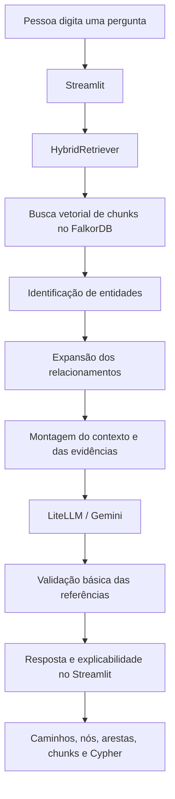

<div align="center">

# 🛡️ CTI GraphRAG

### Inteligência de Ameaças Cibernéticas com busca híbrida e GraphRAG

**Faça perguntas sobre grupos de ameaças, softwares, técnicas e relacionamentos documentados — e consulte as evidências que fundamentam cada resposta.**


</div>

---

## 📌 Sobre o projeto

O **CTI GraphRAG** é um protótipo de pesquisa em *Cyber Threat Intelligence* (CTI). Seu objetivo é permitir que uma pessoa faça perguntas em linguagem natural e receba respostas construídas a partir de informações recuperadas de um grafo de conhecimento.

Em vez de depender somente do conhecimento geral de um modelo de inteligência artificial, o sistema combina:

- **FalkorDB:** armazena entidades, relacionamentos, documentos e trechos de texto (*chunks*).
- **Busca vetorial:** localiza trechos semanticamente relacionados à pergunta.
- **Recuperação no grafo:** identifica entidades citadas nos trechos e expande seus relacionamentos.
- **LiteLLM + Gemini:** transforma as evidências recuperadas em uma resposta em português.
- **Streamlit:** apresenta o chat, as referências, os caminhos, o subgrafo e as consultas Cypher utilizadas.

> [!IMPORTANT]
> Este projeto ainda está em desenvolvimento. Este README ensina a iniciar a aplicação e reproduzir o protótipo funcional descrito aqui. A carga dos dados em uma instalação nova depende dos arquivos de ingestão e dos dados de origem estarem disponíveis. Consulte a seção [Dados e reprodução em outra máquina](#-dados-e-reprodução-em-outra-máquina) antes de esperar encontrar o mesmo conteúdo em um computador novo.

## 🧭 Índice

- [Como funciona](#-como-funciona)
- [O que a aplicação apresenta](#-o-que-a-aplicação-apresenta)
- [Tecnologias utilizadas](#-tecnologias-utilizadas)
- [Pré-requisitos](#-pré-requisitos)
- [Instalação no Windows](#-instalação-no-windows)
- [Configuração do arquivo `.env`](#-configuração-do-arquivo-env)
- [Iniciar o FalkorDB](#-iniciar-o-falkordb)
- [Verificar os dados do grafo](#-verificar-os-dados-do-grafo)
- [Executar a aplicação](#-executar-a-aplicação)
- [Perguntas para testar](#-perguntas-para-testar)
- [Estrutura do projeto](#-estrutura-do-projeto)
- [Solução de problemas](#-solução-de-problemas)
- [Cuidados importantes](#-cuidados-importantes)
- [Referências](#-referências)

---

## 🔄 Como funciona

O fluxo simplificado da aplicação é:



### Em palavras simples

1. Você escreve uma pergunta, por exemplo: **“Quais ferramentas são utilizadas pelo grupo Andariel?”**
2. O sistema transforma a pergunta em um vetor e procura os trechos mais relacionados no FalkorDB.
3. As entidades mencionadas nesses trechos são identificadas.
4. O recuperador consulta os relacionamentos dessas entidades.
5. As evidências são organizadas e enviadas ao Gemini.
6. O Gemini redige uma resposta e utiliza referências como `[P1]` e `[P2]`.
7. A interface apresenta a resposta e os dados usados para construí-la.

As referências indicam os caminhos de evidência montados pelo pipeline. A validação atual verifica se as referências citadas existem entre os caminhos recuperados; ela ainda não comprova semanticamente cada afirmação da resposta.

## 🖥️ O que a aplicação apresenta

Na interface, você encontrará:

| Área | O que mostra |
|---|---|
| Chat | Campo para perguntas e histórico da conversa. |
| Resposta | Texto produzido pelo Gemini com referências como `[P1]`. |
| Indicador de recuperação | Média das similaridades semânticas recuperadas, apresentada como percentual. Não é uma probabilidade de acerto. |
| Tempo total | Tempo gasto no processamento da pergunta. |
| Caminhos e evidências | IDs dos nós, tipos de relacionamento e IDs dos chunks usados. |
| Visualização do subgrafo | Nós e arestas relacionados à resposta. |
| Consultas Cypher | Consultas registradas durante a recuperação. |

## 🧰 Tecnologias utilizadas

| Tecnologia | Função |
|---|---|
| Python | Linguagem principal. |
| Streamlit | Interface web interativa. |
| FalkorDB | Banco de dados de grafos e busca vetorial. |
| FalkorDB Python Client | Comunicação entre Python e o banco. |
| Sentence Transformers | Geração do vetor da pergunta. |
| `intfloat/multilingual-e5-small` | Modelo de embeddings usado pelo recuperador atual. |
| LiteLLM | Integração padronizada com o provedor de LLM. |
| Gemini API | Geração das respostas em linguagem natural. |
| Pydantic | Estruturação do objeto de resposta (`Answer`). |
| PyVis | Visualização interativa do subgrafo. |
| python-dotenv | Leitura das configurações do `.env`. |

> [!NOTE]
> O recuperador atual carrega `intfloat/multilingual-e5-small` diretamente no código e usa vetores de 384 dimensões. O modelo definido no código e o modelo usado para gerar os embeddings já armazenados nos `Chunk` precisam ser compatíveis. Não troque o modelo sem gerar novamente os embeddings dos chunks e conferir o índice vetorial.

---

## ✅ Pré-requisitos

Antes de começar, instale:

1. **Git** — para obter o código do repositório.
2. **Python 3.11 ou superior** — o Streamlit documenta suporte às versões 3.11 a 3.15. Outras bibliotecas do projeto também precisam ser compatíveis com a versão escolhida.
3. **Docker Desktop** — para executar o FalkorDB no Windows. No Windows, mantenha o mecanismo Linux/WSL 2 do Docker Desktop funcionando.
4. **Acesso à internet** — necessário para instalar dependências, baixar o modelo de embeddings na primeira execução e acessar a API Gemini.
5. **Chave da Gemini API** — obtida no Google AI Studio.

Links úteis:

- [Python](https://www.python.org/downloads/)
- [Git for Windows](https://git-scm.com/downloads/win)
- [Docker Desktop](https://www.docker.com/products/docker-desktop/)
- [Google AI Studio — criar chave de API](https://aistudio.google.com/app/apikey)

---

## 🪟 Instalação no Windows

> Execute os comandos abaixo no **PowerShell**. Sempre que abrir um novo terminal, volte para a pasta do projeto e ative o ambiente virtual antes de executar comandos Python.

### 1. Abra a pasta do projeto

Se o projeto já estiver no computador:

```powershell
cd C:\caminho\para\Dados-para-CiberSeguranca
```

Substitua o caminho de exemplo pelo local real da pasta. Os próximos comandos devem ser executados na raiz do projeto — a pasta onde ficam `src`, `data`, `schema` e `requirements.txt`.

### 2. Crie um ambiente virtual

O ambiente virtual mantém as bibliotecas deste projeto separadas de outros projetos Python.

```powershell
python -m venv venv
```

### 3. Ative o ambiente virtual

```powershell
.\venv\Scripts\Activate.ps1
```

Quando funcionar, o início da linha do terminal ficará parecido com:

```text
(venv) PS C:\...\Dados-para-CiberSeguranca>
```

**Se o PowerShell bloquear a ativação**, execute uma vez:

```powershell
Set-ExecutionPolicy -ExecutionPolicy RemoteSigned -Scope CurrentUser
```

Confirme a alteração, feche e abra o terminal e tente ativar o ambiente novamente.

### 4. Atualize o instalador de pacotes

```powershell
python -m pip install --upgrade pip
```

### 5. Instale as dependências

Se o repositório tiver `requirements.txt` atualizado:

```powershell
pip install -r requirements.txt
```

Se algum pacote usado pela aplicação ainda não estiver listado, instale o conjunto necessário:

```powershell
pip install falkordb sentence-transformers litellm python-dotenv streamlit pyvis pydantic
```

Para executar também o importador Brandefense, podem ser necessárias dependências adicionais, como `pycountry` e `PyYAML`:

```powershell
pip install pycountry pyyaml
```

### 6. Confira as dependências principais

```powershell
python -c "import streamlit, pyvis, pydantic, falkordb, litellm, sentence_transformers; print('Dependências principais instaladas com sucesso!')"
```

Se aparecer a mensagem de sucesso, continue.

---

## 🔐 Configuração do arquivo `.env`

O arquivo `.env` guarda as configurações locais da aplicação e a chave de acesso à Gemini API.

### 1. Crie o arquivo

Na raiz do projeto, crie um arquivo chamado exatamente `.env` — sem extensão `.txt`.

Se houver um arquivo `.env.example`, você pode copiá-lo:

```powershell
Copy-Item .env.example .env
```

Se não houver, crie o `.env` manualmente.

### 2. Preencha as configurações

Use este modelo:

```env
# FalkorDB
FALKORDB_HOST=127.0.0.1
FALKORDB_PORT=6379
GRAPH_NAME=cti_gold

# Gemini via LiteLLM / Google AI Studio
LLM_PROVIDER=gemini
LLM_MODEL=gemini/gemini-3.8-flash
GEMINI_API_KEY=COLOQUE_SUA_CHAVE_AQUI
```

Substitua `COLOQUE_SUA_CHAVE_AQUI` pela chave criada no Google AI Studio. Não coloque a chave entre aspas.

### 3. Como criar a chave Gemini

1. Acesse [Google AI Studio — API keys](https://aistudio.google.com/app/apikey).
2. Entre com sua conta Google.
3. Crie uma chave de API.
4. Copie a chave e cole no campo `GEMINI_API_KEY` do `.env`.
5. Salve o arquivo.

O nome do modelo pode mudar com o tempo. O exemplo acima usa o identificador `gemini-3.8-flash`; confira os modelos disponíveis na [documentação oficial do Gemini](https://ai.google.dev/gemini-api/docs/models). Para o LiteLLM com chave do Google AI Studio, mantenha o prefixo `gemini/` antes do identificador do modelo.

### 4. Verifique sem revelar a chave

Execute:

```powershell
python -c "from dotenv import load_dotenv; import os; load_dotenv(); print('Modelo:', os.getenv('LLM_MODEL')); print('Chave configurada:', bool(os.getenv('GEMINI_API_KEY')))"
```

O resultado esperado é semelhante a:

```text
Modelo: gemini/gemini-3.8-flash
Chave configurada: True
```

> [!CAUTION]
> Nunca publique, envie por mensagem ou faça commit da sua chave API. O `.env` deve estar no `.gitignore`. Se a chave for exposta, revogue-a no Google AI Studio e gere outra.

---

## 🗄️ Iniciar o FalkorDB

O FalkorDB é o banco que armazena o grafo. A aplicação Python depende dele para realizar as buscas.

### Opção A — já existe um container chamado `cti-falkordb`

Se você já executou o projeto anteriormente, tente iniciar o container existente:

```powershell
docker start cti-falkordb
```

Confira se está ativo:

```powershell
docker ps --filter "name=cti-falkordb"
```

Se ele já estiver rodando, não é necessário criar outro container.

### Opção B — primeira instalação do FalkorDB

Se ainda não existir um container, execute:

```powershell
docker run -d `
  --name cti-falkordb `
  --restart unless-stopped `
  -p 6379:6379 `
  -p 3000:3000 `
  -v cti_falkordb_data:/var/lib/falkordb/data `
  falkordb/falkordb:latest
```

Esse comando cria e inicia o FalkorDB com um volume Docker chamado `cti_falkordb_data`, para manter os dados entre reinicializações do container.

Confira:

```powershell
docker ps --filter "name=cti-falkordb"
```

As portas utilizadas são:

| Porta | Serviço |
|---|---|
| `6379` | Conexão da aplicação Python com o FalkorDB. |
| `3000` | FalkorDB Browser, interface web de consulta. |

O Browser fica disponível em [http://localhost:3000](http://localhost:3000).

### Testar a conexão com o banco

No PowerShell:

```powershell
Test-NetConnection 127.0.0.1 -Port 6379
```

Procure:

```text
TcpTestSucceeded : True
```

Isso indica que a porta está acessível. Ainda será necessário confirmar que o grafo esperado existe e contém dados.

> [!WARNING]
> Não execute `docker rm -v`, não exclua o volume `cti_falkordb_data` e não use `docker compose down -v` como tentativa de corrigir problemas. Esses comandos podem apagar os dados do banco. O FalkorDB Browser também não é necessário para a aplicação funcionar; o projeto acessa o banco diretamente pela porta `6379`.

---

## 📚 Dados e reprodução em outra máquina

Esta é uma etapa importante para quem vai executar o projeto em um computador diferente.

**O código do Git e o banco de dados são coisas separadas.** O grafo salvo dentro do Docker não é copiado automaticamente quando alguém baixa ou clona o repositório. Além disso, arquivos de dados locais podem estar excluídos do Git por `.gitignore`.

### Estado do protótipo documentado

Na versão descrita por este README:

- O grafo local `cti_gold` foi utilizado com uma base experimental derivada do conjunto de dados da [BRANDEFENSE — threat-actor-dataset](https://github.com/BRANDEFENSE/threat-actor-dataset).
- Esse grafo experimental continha grupos, softwares, técnicas, táticas, documentos e chunks, com relacionamentos e embeddings usados pela busca vetorial.
- O arquivo MITRE ATT&CK Enterprise STIX 2.1 versão 20.1 já havia sido baixado e preparado em arquivos intermediários, mas a etapa de carga validada desse conjunto em um grafo de destino ainda estava pendente.
- Portanto, não confunda a base experimental que gerou a demonstração com uma carga oficial completa do MITRE ATT&CK + CISA KEV.

### O que é necessário em uma máquina nova

Para obter respostas como a demonstração com o grupo Andariel, o grafo precisa estar carregado com:

1. Nós e relacionamentos da fonte de dados escolhida.
2. Nós `Document` e `Chunk`.
3. Relacionamentos de procedência `MENTIONED_IN` e `PART_OF`.
4. Embeddings de 384 dimensões nos chunks.
5. Índice vetorial compatível com esses embeddings.

O importador experimental disponível no projeto é `src/cti_graphrag/ingest/ingest_brandefense.py`. Ele espera estes arquivos JSON em `data/raw/`:

```text
data/raw/
├── apt-groups.json
├── ransomware-groups.json
├── malware.json
└── attack-techniques.json
```

Esses arquivos são disponibilizados pelo repositório da [BRANDEFENSE](https://github.com/BRANDEFENSE/threat-actor-dataset). Para baixá-los com Git, execute na raiz do projeto:

```powershell
git clone https://github.com/BRANDEFENSE/threat-actor-dataset.git .\threat-actor-dataset
New-Item -ItemType Directory -Force .\data\raw

Copy-Item .\threat-actor-dataset\data\raw\apt-groups.json .\data\raw\
Copy-Item .\threat-actor-dataset\data\raw\ransomware-groups.json .\data\raw\
Copy-Item .\threat-actor-dataset\data\raw\malware.json .\data\raw\
Copy-Item .\threat-actor-dataset\data\raw\attack-techniques.json .\data\raw\
```

Confira se os quatro arquivos chegaram:

```powershell
Get-ChildItem .\data\raw
```

Depois, o importador pode ser executado pela raiz do projeto:

```powershell
python src\cti_graphrag\ingest\ingest_brandefense.py
```

**Atenção:** esse comando carrega dados no grafo `cti_gold`. Execute-o somente quando souber qual conteúdo já existe nesse grafo. Não apague nem sobrescreva um banco de dados compartilhado ou importante para tentar reproduzir a demonstração.

Após a ingestão, os chunks precisam receber embeddings. O script usado na preparação anterior chama-se `gerar_embeddings.py`. Para localizar sua versão no repositório:

```powershell
Get-ChildItem . -Recurse -Filter gerar_embeddings.py | Select-Object -ExpandProperty FullName
```

Execute o caminho encontrado com `python`, por exemplo, substituindo pelo caminho exibido no seu terminal:

```powershell
python CAMINHO_ENCONTRADO\gerar_embeddings.py
```

O recuperador atual exige embeddings compatíveis com `intfloat/multilingual-e5-small` (384 dimensões). Na geração, os textos dos chunks usam o prefixo `passage:` e a pergunta usa `query:`. Se os chunks estiverem sem embeddings ou tiverem sido vetorizados com outro modelo, a busca vetorial precisará ser preparada novamente antes de abrir o chat. Na primeira execução, o modelo também pode ser baixado automaticamente pelo Sentence Transformers e isso exige internet.

> [!IMPORTANT]
> **Limitação atual de reprodução:** a carga automatizada do ATT&CK 20.1 em um grafo temporário/validado e a geração de embeddings para esse novo conjunto ainda precisam ser finalizadas e documentadas no fluxo de instalação. Em uma máquina limpa, não basta iniciar o Docker e o Streamlit: o grafo também precisa ser povoado. Até essa etapa ser concluída, a forma mais fiel de reproduzir a demonstração é receber/restaurar uma cópia dos dados do FalkorDB já preparados ou seguir o importador experimental e a preparação de embeddings acima.

### Conferir se `cti_gold` contém dados

Com o container ativo e o ambiente virtual ligado, execute na raiz do projeto:

```powershell
python -c "from falkordb import FalkorDB; import os; from dotenv import load_dotenv; load_dotenv(); g=FalkorDB(host=os.getenv('FALKORDB_HOST','127.0.0.1'),port=int(os.getenv('FALKORDB_PORT','6379'))).select_graph(os.getenv('GRAPH_NAME','cti_gold')); print(g.ro_query('MATCH (n) RETURN count(n) AS total').result_set)"
```

Se o banco estiver preenchido, o comando deverá retornar uma contagem maior que zero. Se o grafo estiver vazio ou não existir, a aplicação não terá evidências para responder às perguntas.

---

## ▶️ Executar a aplicação

Antes de iniciar, confira:

- [ ] O ambiente virtual está ativado — aparece `(venv)` no terminal.
- [ ] O arquivo `.env` existe e contém `GEMINI_API_KEY` e `LLM_MODEL`.
- [ ] O container `cti-falkordb` está ativo.
- [ ] O grafo configurado em `GRAPH_NAME` contém chunks, embeddings e relacionamentos.

Na raiz do projeto, execute:

```powershell
python -m streamlit run src/cti_graphrag/ui/app.py
```

O terminal mostrará um endereço local. Normalmente a aplicação abrirá em:

[http://localhost:8501](http://localhost:8501)

Se o navegador não abrir automaticamente, copie o endereço e cole no navegador.

### Encerrar a aplicação

Volte ao terminal onde o Streamlit está rodando e pressione:

```text
Ctrl + C
```

Para parar o FalkorDB sem apagar seus dados:

```powershell
docker stop cti-falkordb
```

Para iniciar novamente:

```powershell
docker start cti-falkordb
```

---

## 💬 Perguntas para testar

Depois que a aplicação abrir, experimente perguntas como:

| Pergunta | O que observar |
|---|---|
| `Quais ferramentas são utilizadas pelo grupo Andariel?` | Softwares relacionados ao grupo e evidências citadas. |
| `Quais técnicas são utilizadas pelo grupo Andariel?` | Relacionamentos com técnicas, quando presentes na base. |
| `Quais grupos utilizam [nome de um software]?` | Recuperação dos relacionamentos no sentido inverso. |
| `O que é [nome de uma técnica]?` | Trechos documentais e entidades relacionadas, quando disponíveis. |

A resposta depende do conteúdo carregado no grafo. Uma pergunta pode não retornar resultados caso a informação não esteja presente nos chunks ou nos relacionamentos disponíveis.

---

## 📂 Estrutura do projeto

Estrutura simplificada dos módulos usados pela aplicação atual:

```text
Dados-para-CiberSeguranca/
│
├── .env                         # Chave API e configurações locais (não versionar)
├── requirements.txt             # Dependências Python
├── schema/
│   ├── schema.yaml              # Contrato do grafo
│   └── create_indexes.py        # Índices e constraints
│
├── data/
│   ├── raw/                     # Dados de origem
│   └── processed/               # Arquivos intermediários
│
├── src/
│   └── cti_graphrag/
│       ├── ingest/              # Ingestão e preparação dos dados
│       ├── retrieval/
│       │   ├── graph_retriever.py
│       │   └── hybrid_retriever.py
│       ├── llm/
│       │   ├── client.py        # Chamada ao Gemini via LiteLLM
│       │   └── prompts.py       # Instruções do modelo
│       ├── pipeline/
│       │   ├── schemas.py       # Contrato Pydantic Answer
│       │   └── answer.py        # Orquestração GraphRAG
│       └── ui/
│           └── app.py           # Interface Streamlit
│
└── README.md
```

**Importante sobre os imports:** o diretório `src` é o local onde está o pacote `cti_graphrag`; ele não é importado como `src.cti_graphrag`. Nos módulos, use imports como:

```python
from cti_graphrag.retrieval import HybridRetriever
```

---

## 🧯 Solução de problemas

### 1. `ModuleNotFoundError: No module named 'src'`

Algum arquivo está tentando importar `src.cti_graphrag`.

**Como corrigir:** use `cti_graphrag` como pacote principal, sem o prefixo `src.`. Execute o Streamlit pela raiz do projeto.

### 2. `ModuleNotFoundError: No module named 'cti_graphrag'`

Normalmente o comando foi executado fora da raiz do projeto ou o caminho `src` não foi adicionado ao caminho de importação.

**Como conferir:**

```powershell
Get-Location
Test-Path .\src\cti_graphrag
```

O segundo comando deve retornar `True`.

### 3. `UnboundLocalError: cannot access local variable 'query'`

O registro da consulta foi colocado antes da variável `query` ser criada.

**Como corrigir:** em `hybrid_retriever.py` e `graph_retriever.py`, a ordem deve ser:

```python
query = """ ... consulta Cypher ... """
self.last_queries.append(query.strip())
rows = self.graph.ro_query(query, params={...}).result_set
```

### 4. Gemini retorna `400 Bad Request` ou `unexpected model name format`

Confira se `LLM_MODEL` contém um identificador válido e o prefixo do provedor:

```env
LLM_MODEL=gemini/gemini-3.8-flash
```

Confira também se `GEMINI_API_KEY` está preenchida e ativa. Não use o texto de exemplo `SEU_MODELO` como nome real do modelo.

### 5. `ReadTimeout` ao chamar o Gemini

A chamada demorou mais que o tempo limite ou a conexão com a API ficou instável.

- Confira sua conexão com a internet.
- Confira se a chave e o modelo estão corretos.
- Verifique a disponibilidade e os limites da API no Google AI Studio.
- O cliente atual foi configurado com timeout de 120 segundos; uma resposta ainda pode exceder esse período.

### 6. FalkorDB não conecta (`Connection refused` / timeout)

Confira se o Docker Desktop está aberto e se o container está ativo:

```powershell
docker ps --filter "name=cti-falkordb"
Test-NetConnection 127.0.0.1 -Port 6379
```

Se o container já existir e estiver parado:

```powershell
docker start cti-falkordb
```

### 7. A aplicação abre, mas diz que não encontrou evidências

Verifique:

- Se `GRAPH_NAME` aponta para o grafo correto.
- Se o grafo possui nós `Chunk` com texto e embedding.
- Se os chunks estão ligados às entidades por `MENTIONED_IN`.
- Se os chunks estão ligados aos documentos por `PART_OF`.
- Se o índice vetorial usa 384 dimensões e é compatível com o modelo de embeddings atual.

### 8. O FalkorDB Browser mostra `ERR invalid graph version`

O Browser é uma ferramenta separada da aplicação. O CTI GraphRAG conversa diretamente com o banco pela porta `6379`, portanto um erro na interface Browser não significa automaticamente que a conexão Python esteja quebrada.

Teste a conexão pelo Python com o comando da seção [Verificar os dados do grafo](#-verificar-os-dados-do-grafo).

### 9. A resposta demora muito

O tempo total inclui recuperação vetorial, identificação de entidades, expansão do grafo e geração pelo LLM. O protótipo já apresentou execuções próximas de 92 segundos.

A otimização das consultas e a medição separada do tempo de cada etapa ainda são melhorias planejadas. Uma resposta lenta não deve ser interpretada automaticamente como falha do banco.

---

## 🔒 Cuidados importantes

- Não publique o arquivo `.env` nem a chave Gemini.
- Não remova volumes Docker para tentar corrigir problemas de conexão.
- Não altere o modelo de embeddings sem regenerar os vetores já armazenados.
- Não interprete o indicador de recuperação como percentual de certeza da resposta.
- Confira os caminhos e os trechos documentais antes de usar uma resposta como conclusão de investigação.
- A ausência de evidências significa apenas que o sistema não recuperou suporte suficiente na base consultada; não prova que um evento ou relacionamento não exista.

Sugestão de `.gitignore`:

```gitignore
# Segredos e ambiente Python
.env
venv/
.venv/
__pycache__/
*.py[cod]

# Dados locais e arquivos intermediários
/data/raw/
/data/processed/

# Arquivos temporários
*.log
.streamlit/secrets.toml
```

Ajuste o `.gitignore` se a equipe decidir versionar algum arquivo de dados público e pequeno. Nunca versione chaves ou segredos.

---

## 🗺️ Próximas etapas do projeto

O protótipo atual já conecta recuperação híbrida, geração de resposta e interface. As próximas melhorias previstas incluem:

- Otimizar a expansão do grafo e reduzir o tempo de resposta.
- Diferenciar de forma explícita `Tool` e `Malware` na apresentação dos softwares.
- Fortalecer a validação de afirmações e referências.
- Implementar recuperação multi-hop e caminhos completos.
- Implementar Text-to-Cypher com validação estrita de consultas somente de leitura.
- Integrar algoritmos de grafo, como PageRank e detecção de comunidades, conforme o planejamento.
- Finalizar a carga oficial MITRE ATT&CK + CISA KEV e a avaliação com as 30 perguntas.

---

## 📖 Referências e documentação oficial

- [FalkorDB — Docker e Docker Compose](https://falkordb.github.io/docs-staging/operations/docker/)
- [FalkorDB — Persistência de dados](https://falkordb.github.io/docs-staging/operations/persistence/)
- [Streamlit — Instalação pela linha de comando](https://docs.streamlit.io/get-started/installation/command-line)
- [LiteLLM — Provedores de modelos](https://docs.litellm.ai/docs/providers)
- [Google AI Studio — Gemini API](https://aistudio.google.com/docs/get-started)
- [Gemini API — Modelos disponíveis](https://ai.google.dev/gemini-api/docs/models)
- [MITRE ATT&CK — STIX Data](https://github.com/mitre-attack/attack-stix-data)
- [BRANDEFENSE — Threat Actor Dataset](https://github.com/BRANDEFENSE/threat-actor-dataset)
- [CISA — Known Exploited Vulnerabilities Catalog](https://www.cisa.gov/known-exploited-vulnerabilities-catalog)

---

<div align="center">

**CTI GraphRAG** · Protótipo acadêmico de Inteligência de Ameaças Cibernéticas

*Consulte as evidências. Entenda os relacionamentos. Investigue com contexto.*

</div>
